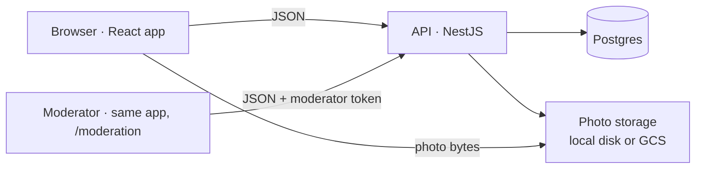
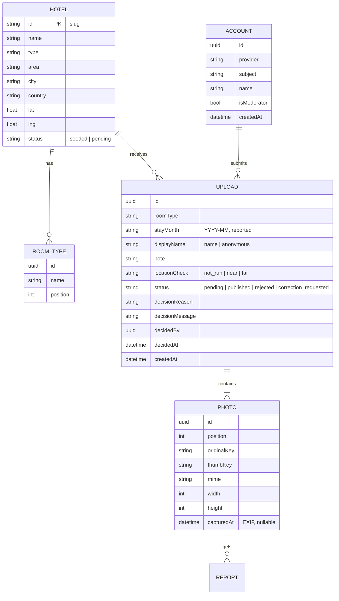
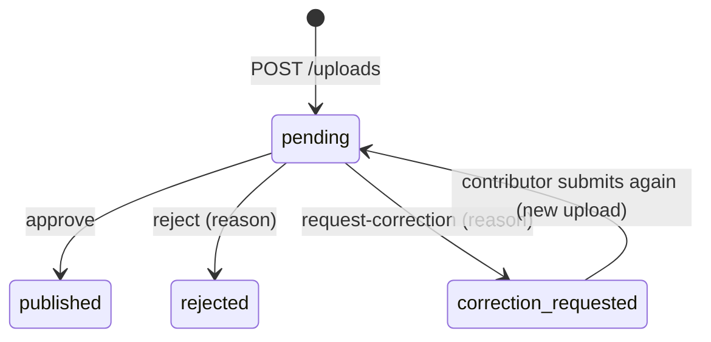

# RealStay — architecture

A small system with one hard problem: showing photos that are honest about what they are. Everything below serves that.

## Components

- **App** (`app/`): React + Vite, a direct port of the design prototype's HTML, CSS and interaction model. Hash routing, no state library, one typed API client. The draft of a contribution lives in memory for the session (files cannot be persisted in `localStorage`).
- **API** (`api/`): NestJS + TypeORM. Four modules: `hotels` (read), `uploads` (write, contributor), `moderation` (write, moderator), `auth`. Two interfaces hide the environment: `PhotoStorage` (local disk, GCS) and the auth provider (dev; Google via Firebase Auth is the documented swap).
- **Postgres**: the source of truth. In the prototype the schema is synchronised from the entities; a production service would use generated migrations.

## Data model

**The upload is the unit, not the photo.** A guest shares up to three photos of one stay; they share a hotel, room type, stay month, contributor and location result, so they are stored, moderated and shown together. The gallery renders one card per upload and the viewer moves within the upload.

## Trust and freshness are derived, never stored

`api/src/domain/trust.ts` holds the rules as pure functions, unit-tested:

| Fact stored | Derived on read | Shown as |
|---|---|---|
| `locationCheck = near` | `trust = location` | "Location checked" with the sentence "This does not prove where the photo was taken." |
| anything else | `trust = community` | "Community photo" |
| `stayMonth` more than 12 whole months before today | `stale = true` | clock mark on the card and the room-type chip; a notice when a whole filter is stale |
| `stayMonth`, `createdAt`, `photo.capturedAt` | three separate dates | "Stay · reported by the contributor", "Uploaded", "Photo taken · from the file's own data" |

There is no score, no percentage, no "verified" badge. "Stay verified" is a reserved label for a future evidence source (a booking confirmation) and appears nowhere in the code paths that render.

## Publication state machine

Only `published` uploads leave the read endpoints (`GET /hotels`, `GET /hotels/:id`, `GET /hotels/:id/uploads`). A decision on a non-pending upload returns 409 so two moderators cannot double-decide. Approving an upload for a hotel a contributor added flips that hotel from `pending` to visible.

## Location check without storing location

1. The browser asks for the device position (only when the contributor presses "Check my location now").
2. `POST /hotels/:id/location-preview` returns `near | far` for the form, storing nothing.
3. After the upload is created, `POST /uploads/:id/location-check` computes the distance (haversine, 500 m radius, configurable) and stores **only** `near` or `far`. The entity has no coordinate columns, so nothing can leak later. Request bodies are not logged.

## API

| Method and path | Auth | Purpose |
|---|---|---|
| `GET /hotels?q=` | none | Word-based search; `mode` tells the client whether to list or open directly |
| `GET /hotels/:id` | none | Summary with per-room-type count, latest stay and staleness |
| `GET /hotels/:id/uploads?roomType=&sort=stay\|added\|oldest` | none | Published uploads with photos |
| `POST /hotels/:id/location-preview` | none | Stateless near/far |
| `POST /auth/dev` | none | Development sign-in (name → account; `moderator: true` grants the flag). Disabled when `AUTH_PROVIDER != dev` |
| `POST /uploads` | bearer | Multipart, 1–3 photos, fields; validation errors name the file |
| `POST /uploads/:id/location-check` | bearer, owner | Stores near/far |
| `GET /uploads/:id` | bearer, owner | Contributor's view incl. moderation outcome |
| `GET /moderation/queue` | moderator | Pending uploads, oldest first, with signals |
| `POST /moderation/:id/approve\|reject\|request-correction` | moderator | Decisions; 409 when not pending |

Search: tokens in any order, accents stripped, each token a prefix of a word in name/type/area/city/country, one edit tolerated on tokens of 5+ letters. Exact (prefix-only) matches rank before fuzzy ones; a single exact hit opens the hotel directly. At this scale it runs in process over the hotel list; the first thing to change at 10× is moving it to `pg_trgm`.

## Abuse and privacy, as built and as planned

- Writes need an account; the dev provider is clearly labelled and disabled by configuration in any environment that sets a real provider.
- Photos are private objects served through signed URLs (GCS) or the API (local). Nothing is public by bucket policy.
- Contributors choose "first name and initial" or "anonymous"; emails are never stored (the provider subject is).
- Not built: rate limiting beyond a per-token cap, image classification, duplicate detection (a perceptual hash per photo is the obvious next signal), report handling UI (reports are stored, not yet surfaced).

## What breaks first at 10× or 100×

1. **Search** in process → `pg_trgm` index, then a search service only if the catalogue grows past hotels.
2. **Thumbnails synchronously in the request** → a queue (the upload returns immediately, the thumbnail arrives seconds later).
3. **One moderator, no locking** → claim-on-open with a lease, and a reports queue separate from the pending queue.
4. **Signed URLs per card** (one per photo per request) → a CDN in front of the bucket with public-read thumbnails and private originals.
5. **Hotel catalogue** → an import from a hotel data provider instead of contributors adding hotels.

## Deployment

- `docker compose up`: Postgres, API (seeds on first boot), app on nginx.
- Hosted: Cloud Run (API, `STORAGE=gcs`, `API_PREFIX=api`), Cloud SQL database on a shared instance, GCS bucket for photos, static origin behind the existing load balancer at `realstay.dialogislabs.com`, all defined in the Dialogis infrastructure repository; GitHub Actions deploy on push to `main` via Workload Identity Federation (`.github/workflows/ci-deploy.yml`).
